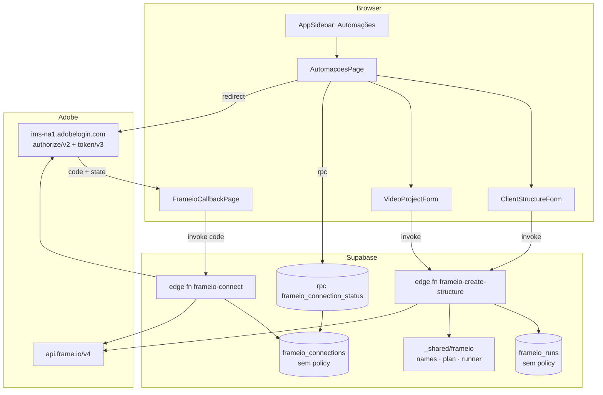

# Automations Design

**Spec**: `.specs/features/automations/spec.md`
**Status**: Approved

---

## Architecture Overview

A client-side page drives two things: an OAuth redirect (browser → Adobe → de volta) and a single edge-function call that runs the whole folder-creation flow. **All Frame.io traffic happens in the edge function** — the browser never holds a Frame.io token and never sees the `client_secret`.



---

## Approach Exploration

Three forks had more than one viable answer. Recommendation first in each.

### Fork A — who orchestrates the Frame.io calls

| # | Approach | Trade-off |
| - | -------- | --------- |
| **A1** ⭐ | **Edge function runs the entire flow.** Client sends `{client_id, flow, params}`; function resolves tokens, walks the plan, throttles, returns a result. | Token never leaves the server; the ≥350 ms throttle is reliable; one round trip; one place for 401/429 handling. The function is ~250 lines of glue over a tested shared module. |
| A2 | Generic `frameio-proxy`: client makes one HTTP call per Frame.io call. | Function is tiny, but the browser drives a multi-step sequence, the throttle depends on client timing, and every step is a separate failure surface. |
| A3 | Client calls Frame.io directly with the access token. | Rejected outright — puts a Frame.io credential in the bundle and contradicts the whole point of keeping secrets server-side. |

**Chosen: A1.**

### Fork B — how the page learns whether the workspace is connected

| # | Approach | Trade-off |
| - | -------- | --------- |
| **B1** ⭐ | **`SECURITY DEFINER` RPC `frameio_connection_status()`** returning only non-secret columns, gated on `is_workspace_admin`. | Base table keeps **zero** client policies, so no code path can `select('*')` a token into the browser. Precedent exists: `get_my_workspace_id()`. No extra round trip through an edge function. |
| B2 | A `frameio-status` edge function. | Also safe, but adds a deployable unit and a network hop for a boolean. |
| B3 | Base table with admin-only RLS, client reads it directly. | Simplest, but the browser then holds the refresh token — a single careless `select('*')` anywhere leaks full Frame.io access. |

**Chosen: B1.**

### Fork C — where the OAuth redirect lands

| # | Approach | Trade-off |
| - | -------- | --------- |
| **C1** ⭐ | **React route `/auth/frameio/callback`.** Reads `code` + `state`, validates `state` against `sessionStorage`, then forwards the `code` to `frameio-connect`. | Matches the existing `AuthCallback` route; real UI for every failure mode; the token exchange itself stays server-side. The `code` is single-use and short-lived, and is bound to `client_id`/`client_secret` at exchange. |
| C2 | Edge function is the `redirect_uri` itself; it exchanges and 302s back to the app. | `code` never touches the browser, but every error must be encoded into a redirect, and the function needs `verify_jwt = false` to accept a bare GET. |

**Chosen: C1.**

---

## Code Reuse Analysis

### Existing Components to Leverage

| Component | Location | How to Use |
| --------- | -------- | ---------- |
| `businessNavItems` | `src/components/layout/AppSidebar.tsx:44-68` | Append `{ title: 'Automações', url: '/pj/automacoes', icon: Zap }` immediately before `Ferramentas`. |
| Nested `/pj/*` route block | `src/App.tsx:268-375` | Add `<Route path="/pj/automacoes" element={…} />` inside the same guarded block, and `/auth/frameio/callback` next to `AuthCallback` at `src/App.tsx:145`. |
| `AuthCallback` | `src/pages/AuthCallback.tsx` | Copy the shape: status state machine, `sanitizeErrorMessage`, redirect-after-success. |
| `get_my_workspace_id()` RPC | `supabase/migrations/20260218161244_…:45-55` | The workspace for every query and for the status RPC. `SECURITY DEFINER` + `SET search_path = public` + `GRANT EXECUTE … TO authenticated` is the template. |
| `is_workspace_admin(ws, uid)` | `supabase/migrations/20260218161244_…:72` | Admin gate for the status RPC and inside both edge functions. |
| `appointment_notification_log` | `supabase/migrations/20261019120000_collaborator_agenda_schema.sql:66-71,166` | **The model for both new tables**: RLS enabled, *no* policies, so only `service_role` reads them. Comment there says it outright: "só service_role enxerga". |
| `update_updated_at_column()` | same migration, trigger block | Reused verbatim on `frameio_connections` and `frameio_runs`. |
| Caller-validation in edge functions | `supabase/functions/generate-client-portal-link/index.ts:31-60` | `Authorization` header → `auth.getUser()` → `workspace_members.role` check. Same three steps in both new functions. |
| `supabase.functions.invoke(name, { body })` | e.g. `src/lib/cobrancas.ts:94` | The only client→function call style used here. |
| `Deno.env.get` for secrets | `supabase/functions/notify-appointment/index.ts:82-84` | `FRAMEIO_CLIENT_ID` / `FRAMEIO_CLIENT_SECRET` / `FRAMEIO_REDIRECT_URI`. |
| TanStack Query mutation + toast | `src/hooks/useCollaboratorAppointments.ts` | Loading/disabled state and the `Tentar novamente` affordance. |

### Integration Points

| System | Integration Method |
| ------ | ------------------ |
| Adobe IMS | `GET ims-na1.adobelogin.com/ims/authorize/v2`, `POST …/ims/token/v3` (`grant_type=authorization_code` then `grant_type=refresh_token`) |
| Frame.io v4 | `GET /v4/accounts`, `GET /v4/accounts/{id}/workspaces`, `GET|POST /v4/accounts/{id}/workspaces/{wid}/projects`, `GET|POST /v4/accounts/{id}/folders/{fid}/folders` |
| Supabase Auth | `supabase.auth.getUser()` inside both edge functions |
| Postgres | 2 tables (no client policies) + 1 `SECURITY DEFINER` RPC |

---

## Components

### `src/pages/PJ/AutomacoesPage.tsx`

- **Purpose**: The Automações menu target — connection card, then the two automation forms.
- **Interfaces**: default export, no props.
- **Dependencies**: `useFrameioConnection`, `FrameioConnectionCard`, `ClientStructureForm`, `VideoProjectForm`.
- **Reuses**: page shell/layout conventions of `src/pages/PJ/*`.
- **Behaviour**: renders nothing but the shell while status is loading; `requires_reconnect` shows `Reconectar Frame.io` instead of the forms (AUTH-09); no connection shows only the connect action (AUTH-06).

### `src/components/automacoes/FrameioConnectionCard.tsx`

- **Purpose**: Shows connected/not-connected state and starts the OAuth redirect.
- **Interfaces**: `{ status: FrameioConnectionStatus }`.
- **Dependencies**: none beyond UI primitives.
- **Reuses**: `Card`/`Button` from `src/components/ui`.

### `src/pages/Auth/FrameioCallbackPage.tsx`

- **Purpose**: Receives `?code=&state=`, validates `state`, forwards the code, reports the outcome (AUTH-02/03).
- **Interfaces**: default export; reads `window.location.search`.
- **Dependencies**: `supabase.functions.invoke('frameio-connect')`, `sessionStorage['frameio_oauth']`.
- **Reuses**: `AuthCallback` status-machine and error-sanitising shape.
- **Security**: deletes the `sessionStorage` entry immediately after reading it (single use); sanitises any Adobe-supplied `error_description` before display.

### `src/components/automacoes/ClientStructureForm.tsx`

- **Purpose**: Flow A — pick a client, submit, show the run result.
- **Interfaces**: `{ clients: ClientOption[]; onRun: (clientId: string) => Promise<RunResult> }`.
- **Dependencies**: `useFrameioCreateStructure`, `RunResult`.
- **Reuses**: existing select primitives used across `src/pages/PJ`.

### `src/components/automacoes/VideoProjectForm.tsx`

- **Purpose**: Flow B — client + date + type + project name, submit, show the run result.
- **Interfaces**: `{ clients: ClientOption[]; onRun: (input: VideoProjectInput) => Promise<RunResult> }`.
- **Dependencies**: same as above.
- **Behaviour**: live preview of the folder name it will create (`2026-11-05_Quinta-Video-Lancamento`), so the user sees the exact result before committing.

### `src/components/automacoes/RunResult.tsx`

- **Purpose**: Renders success / partial / failure honestly — created vs already-existing vs not-created (STRU-07, PART-01/02, FAIL-01).
- **Interfaces**: `{ result: RunResult; onRetry: () => void }`.
- **Reuses**: `Toast` conventions already in the repo.

### `src/hooks/useFrameioConnection.ts`

- **Purpose**: TanStack Query over `supabase.rpc('frameio_connection_status')`.
- **Returns**: `{ status, isLoading, error }`.

### `src/hooks/useFrameioCreateStructure.ts`

- **Purpose**: Mutation over `supabase.functions.invoke('frameio-create-structure')`; exposes `isPending` for the disabled state (STRU-05, PROJ-11).

### `supabase/functions/frameio-connect/index.ts`

- **Purpose**: Exchange the `code`, resolve the Frame.io account + workspace, upsert the connection row.
- **Steps**: validate JWT caller → admin check → `POST /ims/token/v3` (`grant_type=authorization_code`) → `GET /v4/accounts` (first) → `GET /v4/accounts/{id}/workspaces` (first) → upsert `frameio_connections` on `workspace_id`.
- **Reuses**: caller-validation block from `generate-client-portal-link`.

### `supabase/functions/frameio-create-structure/index.ts`

- **Purpose**: Run Flow A or Flow B end to end.
- **Steps**: validate caller → admin check → sweep stale runs → insert `frameio_runs` (mutex) → resolve/refresh token → ensure project → run the plan → mark run `done`/`failed` → return `RunResult`.
- **I/O only**: `fetch`, `setTimeout`, Supabase client. All decisions come from `_shared/frameio`.

### `supabase/functions/_shared/frameio/names.ts` — pure

```ts
export const CLIENT_FIXED_FOLDERS = ['Contratos', 'Artes', 'Textos e Roteiros', 'Relatórios', 'Vídeos'] as const;
export const MATERIAL_FOLDERS = ['Brutos', 'Cenas de Apoio', 'Editados'] as const;

export function buildMonthFolderName(dateISO: string): string;
// '2026-11-05' -> '2026-11-Novembro'

export function buildProjectFolderName(input: { dateISO: string; tipo: string; nomeProjeto: string }): string;
// '2026-11-05' + 'Video' + 'Lançamento' -> '2026-11-05_Quinta-Video-Lançamento'

export function slugPart(value: string): string;  // whitespace runs -> single '-'
export function weekDayPtBR(dateISO: string): WeekDayPtBR;
```

Weekday and month names are **literal constants**, not `Intl` — `ptBR` locale data is not guaranteed in the Deno edge runtime, and a literal is testable without a locale.

### `supabase/functions/_shared/frameio/plan.ts` — pure

```ts
export type FolderSpec = { path: string[]; name: string };  // path = folder names from the project root down to the parent

export function planClientStructure(): FolderSpec[];
export function planVideoProject(input: { dateISO: string; tipo: string; nomeProjeto: string }): FolderSpec[];

export type ExistingChild = { name: string; id: string };
export type Step =
  | { kind: 'reuse';  path: string[]; name: string; id: string }
  | { kind: 'create'; path: string[]; name: string };

export function planSteps(
  specs: FolderSpec[],
  childrenOf: (path: string[]) => ExistingChild[],
): Step[];
```

`planSteps` is the whole idempotency rule in one pure function (STRU-03/04, PROJ-05/06): it never emits a `create` whose name is already present under that parent.

### `supabase/functions/_shared/frameio/runner.ts` — pure of I/O

```ts
export interface FrameioApi {
  listProjects(): Promise<{ id: string; name: string; root_folder_id: string }[]>;
  createProject(name: string): Promise<{ id: string; root_folder_id: string }>;
  listChildren(parentId: string): Promise<ExistingChild[]>;
  createFolder(parentId: string, name: string): Promise<{ id: string; name: string }>;
}

export interface RunnerOptions {
  delay(ms: number): Promise<void>;          // injected so tests run instantly
  folderIntervalMs?: number;                 // default 350 (STRU-06)
  now(): Date;
}

export async function ensureStructure(args: {
  api: FrameioApi;
  specs: FolderSpec[];
  projectName: string;                       // clients.name
  options: RunnerOptions;
}): Promise<RunResult>;
```

`ensureStructure` walks `planSteps`, resolves each parent id from the ones it has already seen or created, calls `options.delay(folderIntervalMs)` between folder creations, and accumulates `{created, existing}`. On the first thrown error it stops and returns `{status:'failed', createdSoFar, failedAt, remaining}` — which is exactly what PART-01 needs.

> **AD-003 conformance**: the module uses no Deno-specific API. It receives its I/O through `FrameioApi` and `delay`, so Vitest exercises the real orchestration with fakes while the edge function supplies `fetch`-backed implementations. This extends AD-003's *reason* (run the logic without Deno) rather than changing it.

### `supabase/functions/_shared/frameio/tokens.ts` — pure

```ts
export function needsRefresh(expiresAt: Date, skewMs?: number, now?: Date): boolean;  // default skew 5 min (AUTH-08)
export function classifyTokenError(status: number, body: unknown): 'reconnect' | 'retryable' | 'fatal';
```

---

## Data Models

### `public.frameio_connections`

| Column | Type | Notes |
| ------ | ---- | ----- |
| `id` | `uuid` PK | `gen_random_uuid()` |
| `workspace_id` | `uuid` NOT NULL UNIQUE | → `workspaces(id) ON DELETE CASCADE` |
| `frameio_account_id` | `text` NOT NULL | |
| `frameio_account_name` | `text` | display only |
| `frameio_workspace_id` | `text` NOT NULL | |
| `frameio_workspace_name` | `text` | display only |
| `access_token` | `text` NOT NULL | **never leaves the server** |
| `access_token_expires_at` | `timestamptz` NOT NULL | |
| `refresh_token` | `text` NOT NULL | **never leaves the server** |
| `requires_reconnect` | `boolean` NOT NULL DEFAULT `false` | set by AUTH-09 |
| `connected_by` | `uuid` → `auth.users` | |
| `created_at` / `updated_at` | `timestamptz` | `update_updated_at_column()` trigger |

**RLS**: `ENABLE ROW LEVEL SECURITY` and **no policies at all** — the `appointment_notification_log` pattern. Nothing is granted to `authenticated`, so no client query can reach the tokens.

### `public.frameio_runs`

| Column | Type | Notes |
| ------ | ---- | ----- |
| `id` | `uuid` PK | |
| `workspace_id` | `uuid` NOT NULL | → `workspaces(id)` |
| `client_id` | `uuid` NOT NULL | → `clients(id)` |
| `flow` | `text` NOT NULL | `CHECK (flow IN ('client_structure','video_project'))` |
| `params` | `jsonb` NOT NULL | what was requested |
| `status` | `text` NOT NULL DEFAULT `'running'` | `CHECK (IN ('running','done','failed'))` |
| `result` | `jsonb` | `{created:[], existing:[], failedAt, remaining}` |
| `error` | `text` | |
| `started_by` | `uuid` NOT NULL | |
| `started_at` / `finished_at` | `timestamptz` | |

**The concurrency mutex** (Edge Case: leave mid-run, come back, click again):

```sql
CREATE UNIQUE INDEX frameio_runs_one_live_per_client
  ON public.frameio_runs (client_id)
  WHERE status = 'running';
```

One live run per client — which is what the folder tree actually needs, since Flow A and Flow B both write under the same project root. Before inserting, the function sweeps rows stuck in `running` for over 10 minutes (`UPDATE … SET status='failed'`), so a crashed invocation cannot block forever. A unique violation maps to HTTP 409.

**RLS**: enabled, **no policies** — service_role only.

### RPC `public.frameio_connection_status()`

```sql
RETURNS TABLE (
  workspace_id uuid,
  frameio_workspace_name text,
  frameio_account_name text,
  requires_reconnect boolean,
  connected_at timestamptz
)
LANGUAGE sql STABLE SECURITY DEFINER
SET search_path = public
```

Returns the caller's row only when `public.is_workspace_admin(ws, auth.uid())` — AD-006's manager-side predicate, never `has_workspace_access` alone. Follows the `get_my_workspace_id` grant pattern: `REVOKE … FROM public; GRANT EXECUTE … TO authenticated;`.

---

## Error Handling Strategy

| Error Scenario | Handling | User Impact |
| -------------- | -------- | ----------- |
| `state` mismatch on callback | Abort before any server call; wipe `sessionStorage` entry | "Conexão cancelada" error screen |
| Adobe returns `error=…` on callback | Sanitised, truncated to 200 chars (same rule as `AuthCallback`) | Readable Portuguese message |
| Code exchange fails (400/401) | Surface Adobe's `error_description` | "Não foi possível conectar: …" |
| `client_secret` missing from env | Fail fast before any network call | "Integração não configurada no servidor" |
| Refresh token rejected | `requires_reconnect = true`, stop | `Reconectar Frame.io` action (AUTH-09) |
| Frame.io 401 mid-run | Refresh once, retry that call once (RETY-01) | Invisible to the user |
| Frame.io 429 | Wait `Retry-After`, else 1 s; up to 3 attempts (RATE-01) | Brief pause, then normal result |
| Frame.io 5xx / network down | After retries: stop, report `failedAt` + `remaining` (FAIL-01, PART-01) | "Falha em <etapa>" + `Tentar novamente` |
| Nothing created at all | `created: []` → dedicated branch (PART-02) | "Nada foi criado" + `Tentar novamente` |
| Concurrent run | Unique violation → HTTP 409 | "Já existe uma criação em andamento para este cliente" |
| Stale `running` row | Swept after 10 min | No permanent lockout |
| Flow B with no project | Checked **before** any write (PROJ-10) | "Crie primeiro a estrutura do cliente" |
| Frame.io rejects a name | Its message surfaces; nothing partial is reported as success | The raw reason, plus retry |

---

## Risks & Concerns

| Concern | Location | Impact | Mitigation |
| ------- | -------- | ------ | ---------- |
| **Security** — Client Secret was pasted into a chat transcript | — | Anyone with the transcript can mint tokens as the app | **Rotate it in the Adobe console before deploying.** Store only as `FRAMEIO_CLIENT_SECRET`; never in `VITE_*`, never in the repo. AUTH-05 makes this a testable AC. |
| **Security** — production redirect URI is still `https://localhost:8080/callback` | `context.md` | Connection cannot work outside the dev machine; the whole P1 story is dead in production | User registers `https://taskvisiovs.vercel.app/auth/frameio/callback` in the Adobe console. Tracked as a **deploy blocker**, not a code task. |
| **Security** — refresh token readable from the browser | any careless `select('*')` | Full Frame.io account access leaks on XSS | Base tables have **zero** client policies; status comes only from the non-secret RPC (Fork B1). |
| **Fragile** — `clients.name` is the only key linking a client to a Frame.io project | `plan.ts` | Two clients with the same name share one project (EDGE-04) | Accepted and documented; Frame.io exposes no external key we could store instead. |
| **Perf / external** — Frame.io folder limit is 3/s, project 10/min | Frame.io docs | Parallel creation would 429 and leave partial trees | Sequential plan with ≥350 ms between creations (STRU-06) plus 429 retry (RATE-01). |
| **Data lifecycle** — access token expires in ~1 h | Frame.io docs | Every run after the first hour fails | `needsRefresh` with 5-min skew before each run (AUTH-08). Adobe may rotate the refresh token — **always persist a returned `refresh_token`**. |
| **Concurrency** — two runs listing the same parent at the same moment | `frameio-create-structure` | Duplicate folder, violating STRU-03 | `frameio_runs_one_live_per_client` unique partial index + 10-minute stale sweep. |
| **Test coverage gap** — no Deno on this machine (AD-003) | — | The two edge functions themselves are never executed locally | All decision logic lives in `_shared/frameio/*` and runs under Vitest against a fake `FrameioApi`. Live Frame.io verification is deferred to the user, same as the agenda's pending live check. |
| **Test coverage gap** — no test can hit the real Frame.io API | — | Rate-limit and payload drift would only surface in production | Documented endpoints verified by direct probe today; `RunResult` shape is pinned by tests so a drift shows up as a failed contract, not a silent success. |
| **Tech debt** — lint baseline is 202 pre-existing problems | repo | New files could quietly add to it | New files must lint clean; no new debt is accepted into the feature's commit range. |
| **Fragile** — `verify_jwt` default relied upon | `supabase/config.toml` | A default change would let an unauthenticated request reach the functions | Both functions validate the caller anyway (`Authorization` → `auth.getUser()` → admin check), which is required regardless for AD-006. So `verify_jwt` is defence in depth, not the only gate — and `config.toml` is deliberately **not** touched, keeping each new file single-purpose. |
| **Fragile** — `sessionStorage` for the OAuth `state` | `FrameioCallbackPage` | A tampered tab could break the connect flow | `state` is a CSRF nonce, not a credential: the `code` still only exchanges with the correct `client_id`/`client_secret`. Entry is deleted on first read. |

---

## Tech Decisions

| Decision | Choice | Rationale |
| -------- | ------ | --------- |
| Where the flow runs | One edge function per flow entry point | Token and throttle stay server-side; one failure surface (Fork A1) |
| How status is read | `SECURITY DEFINER` RPC | Base table unreachable from the browser (Fork B1) |
| OAuth callback | React route forwarding the code | Matches `AuthCallback`, better error UX (Fork C1) |
| Concurrency guard | `frameio_runs` partial unique index | The Edge Case AC needs enforcement that survives navigation and reload |
| Shared logic style | `_shared/frameio/*` with injected `FrameioApi` | AD-003 conformance plus real coverage of the orchestration |
| Folder throttle | ≥350 ms, sequential | Frame.io allows 3 folder-creates/second |
| Weekday/month names | Literal `ptBR` constants | No guarantee of `Intl` locale data in the edge runtime; literals are testable |
| Secrets | `Deno.env.get('FRAMEIO_*')` | Same pattern as `AGZAP_URL`; AUTH-05 |
| Client selector | `clients` filtered to `is_active` | Populating a picker, not a new capability |
| Status table exposure | Views/RPC only, never the base table | Any future table holding a third-party credential should follow this |

> **Proposed project-level decision — AD-009.** *A table that stores a third-party credential is created with RLS enabled and **no** policies (service_role only), and the client learns its state through a `SECURITY DEFINER` function with a pinned `search_path` that returns only non-secret columns. Edge functions take credentials exclusively from `Deno.env.get`.* Reason: it makes AUTH-05 structural rather than a convention someone can forget. **Appended to `.specs/STATE.md` on design approval.**
