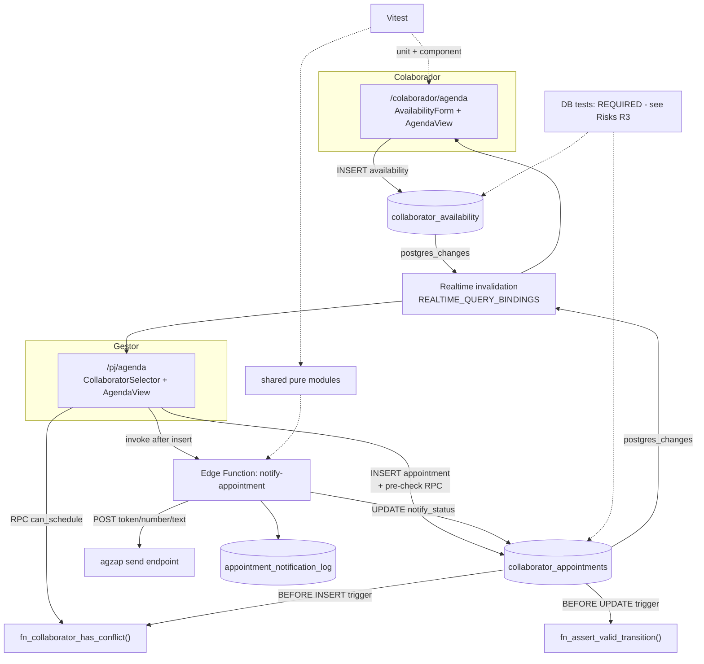

# Collaborator Agenda Design

**Spec**: `.specs/features/collaborator-agenda/spec.md`
**Status**: Draft

---

## Architecture Overview

Three new tables, one new edge function, and an extraction of the existing calendar views. The personal `time_blocks` agenda is not modified in any way — no column, no policy, no query changes.

Authority is deliberately pushed into PostgreSQL. The client renders and pre-checks for feedback; the database decides what is actually allowed. Every rule the spec states as "SHALL refuse" is enforced by a trigger or an RLS policy, so a second tab, a stale UI, or a hand-rolled request cannot bypass it.



The conflict algorithm exists **once**, in SQL. The client calls it as a read-only RPC for instant feedback; the `BEFORE INSERT` trigger calls the same function to decide the write. Two implementations would drift; one implementation with two call sites cannot.

---

## Code Reuse Analysis

### Existing Components to Leverage

| Component | Location | How to Use |
| --------- | -------- | ---------- |
| `AgendaMonthView` / `AgendaDayView` / `AgendaWeekView` / `EventPopoverContent` | `src/components/agenda/AgendaPJ.tsx:411-830` | Extract to `src/components/agenda/views/` as presentational components taking `events` + `mode`. Personal agenda keeps mounting them unchanged; the new feature mounts the same ones. |
| `hasConflict`, `timeToMinutes` | `src/hooks/useAgendaPJ.ts:12-29` | Already exported. Promote to `src/lib/schedule.ts` so both agendas and the tests import from one place without pulling the hook's React Query wiring. |
| `corporate_team` rows already loaded | `src/hooks/useInitializeData.ts:101` | The collaborator selector reads the store — **no new query**. Filter client-side on `is_active && member_user_id`. |
| `has_workspace_access(_workspace_id)` | `supabase/migrations/20260601162729_...:19-37` | The workspace-scoping helper, but **not sufficient on its own here** — collaborators are added to `workspace_members` with role `member` by `supabase/functions/create-collaborator/index.ts:139,189`, so it is true for *every* member and would let collaborator A read collaborator B's rows, breaking COLAB-09. Manager-side predicates therefore use `is_workspace_admin(...) OR is_super_admin(...)` — see Tech Decisions. Never `get_my_workspace_id()` in a policy either — that helper is `LIMIT 1` (risk R8). |
| Collaborator SELECT-own-row policy | `supabase/migrations/20260527151706_...:45-47` | Exact pattern to copy for the new tables' collaborator side. |
| agzap send call | `supabase/functions/process-agenda-reminders/index.ts:49-57` | Body shape `{ token, number, type: "text", message }`, header `Content-Type: application/json`, token from `Deno.env.get("AGZAP_TOKEN")`. Reused verbatim inside the new function. |
| Attempt-dedup table pattern | `supabase/migrations/20260626180000_agenda_reminders.sql:17-26` | RLS enabled with **no policies** → service_role only. Exactly right for `appointment_notification_log`. |
| Realtime publication + `REPLICA IDENTITY FULL` | `supabase/migrations/20260617120000_realtime_react_query_tables.sql:14-46` | The idempotent `DO` block — copy verbatim for both new tables. |
| React Query realtime bindings | `src/lib/realtime-query-config.ts:48` | Append two entries (`table` → `queryKeys`). The existing `time_blocks` entry proves the mechanism. |
| Permission flag plumbing | `src/hooks/useCollaboratorPermissions.ts:8,23-27` | `can('agenda')` already exists with `defaultEnabled: true` and is never checked. Wire it (PERM-01/02), do not invent a second mechanism. |
| Route gate | `src/components/auth/CollaboratorRoute.tsx:15-32` | Wrap the new route exactly as `App.tsx:384-390` wraps `/colaborador`. |
| Error handling in notify chain | `supabase/functions/notify-task-assigned/index.ts:152-167` | Same fetch/timeout/log shape. |

### Integration Points

| System | Integration Method |
| ------ | ------------------ |
| Supabase Postgres | 4 migrations: 3 tables, 4 triggers, 4 SQL functions, 6 RLS policies, realtime publication |
| agzap | New edge function `notify-appointment`, reusing the existing request shape |
| Supabase Realtime | `REALTIME_QUERY_BINDINGS` in `src/lib/realtime-query-config.ts` |
| React Router | One route `/colaborador/agenda` under `CollaboratorRoute` |
| Nav | `AppSidebar.tsx:70-72` (collaborator list) + `MobileNav.tsx:61-72` |
| `collaborator_permissions` | Read-only consumption of the existing `agenda` key |

---

## Components

### `supabase/migrations/<ts>_collaborator_agenda.sql`

- **Purpose**: Creates both calendar tables, the log table, the conflict function, the transition guard, all RLS policies, and the realtime registration.
- **Interfaces**: see Data Models below.
- **Dependencies**: `workspaces`, `workspace_members`, `corporate_team`, `auth.users`, helper `has_workspace_access()`.
- **Reuses**: the `DO`-block realtime pattern and the no-policy log-table pattern already in the repo.

### `supabase/functions/_shared/collaborator-agenda.ts`

- **Purpose**: Pure, dependency-free TypeScript holding the message builder and the shared schedule helpers, so one file serves both the edge function and the test suite.
- **Interfaces**:
  - `buildAppointmentMessage(input: AppointmentMessageInput): string`
  - `formatRange(start: string, end: string): string`
- **Dependencies**: none (no imports from `src/`, no Deno APIs).
- **Reuses**: nothing — but this is what makes NOTIF-01 and NOTIF-09 testable without Deno.

> The edge function imports it with a relative path; Vitest imports the same file. One source of truth, no duplication, no Deno required to test it.

### `supabase/functions/notify-appointment/index.ts`

- **Purpose**: Builds and sends the WhatsApp message for one appointment, records the attempt, and updates `notify_status`.
- **Interfaces**: `POST { appointment_id: string }`
- **Dependencies**: `AGZAP_TOKEN`, `SUPABASE_URL`, `SUPABASE_SERVICE_ROLE_KEY`; `_shared/collaborator-agenda.ts`.
- **Reuses**: agzap body shape from `process-agenda-reminders/index.ts:49-57`; log-table write pattern from `agenda_reminder_events`.
- **Authorization**: keeps `verify_jwt` at its default (`true`) — deliberately **not** added to the `verify_jwt = false` list in `supabase/config.toml:3-45`. The row is read through a client built from the incoming `Authorization` header, so **RLS itself decides** whether the caller may act on that appointment. No re-implementation of the permission check.

### `src/lib/schedule.ts`

- **Purpose**: Schedule primitives shared by both agendas and by the test suite.
- **Interfaces**:
  - `timeToMinutes(t: string): number` — moved from `useAgendaPJ.ts:12-15`
  - `rangesOverlap(a: Interval, b: Interval): boolean`
  - `parseDateOnly(d: string): Date` — always `YYYY-MM-DDT12:00:00`, never `new Date(d)`
  - `formatDateBR(d: string): string`
- **Dependencies**: `date-fns` (already present).
- **Reuses**: existing helpers, relocated.

### `src/components/agenda/views/*`

- **Purpose**: The extracted month/day/week views and popover, now pure.
- **Interfaces**: `events: CalendarEvent[]`, `mode: 'edit' | 'read'`, `onCreate?(slot)`, `onSelect?(event)`.
- **Dependencies**: `CalendarEvent` view-model.
- **Reuses**: `AgendaPJ.tsx:411-830` — **moved, not rewritten**.
- **Concern**: see risk R1. This is the single largest piece of work and the one that can visibly break the manager's daily screen.

### `src/components/agenda/CalendarEvent.ts` (view-model)

```ts
type CalendarEvent = {
  id: string
  date: string        // YYYY-MM-DD
  start: string       // HH:MM
  end: string         // HH:MM
  title: string
  color: string
  kind: 'appointment' | 'unavailability' | 'personal'
  status?: 'pending' | 'confirmed' | 'cancelled'
  conflicted?: boolean
  notes?: string | null
}
```

Both source rows and `time_blocks` map into this shape. The views never learn which table they came from — which is what makes the extraction pay off.

### `src/components/agenda/CollaboratorSelector.tsx`

- **Purpose**: Dropdown of active collaborators with a full account, in the `/pj/agenda` header.
- **Interfaces**: `value: string | null`, `onChange(id: string | null)`, `options: CollaboratorOption[]`.
- **Dependencies**: `useAppStore` team rows (already loaded — no query).
- **Filter**: `is_active === true && member_user_id != null`.

### `src/pages/colaborador/ColaboratorAgendaPage.tsx`

- **Purpose**: The collaborator's own calendar: mark unavailable time, view and answer appointments.
- **Interfaces**: mounted at `/colaborador/agenda`.
- **Dependencies**: `useCollaboratorAvailability`, `useCollaboratorAppointments`, `can('agenda')`, extracted views in `mode='read'` for appointments + availability editing.
- **Reuses**: `CollaboratorPortal.tsx` card/section styling, `ProtectedRoute`/`CollaboratorRoute` gating.

### `src/components/areapj/AvailabilityForm.tsx`

- **Purpose**: Dialog for all five unavailability granularities with the three AVAIL validation rules.
- **Interfaces**: `open`, `initialValues?`, `onSubmit(values)`, `onCancel()`.
- **Dependencies**: `zod` (already present, `^4.4.3`) + `react-hook-form` (already present) + `@hookform/resolvers` (already present).

### `src/hooks/useCollaboratorAvailability.ts` / `useCollaboratorAppointments.ts`

- **Purpose**: React Query CRUD for the two tables, mirroring `useAgendaPJ.ts` exactly (query key, mutation → `invalidateQueries` by prefix, conflict pre-check via RPC before insert).
- **Reuses**: `useAgendaPJ.ts:31-85` as the template — same shape, same conventions.

---

## Data Models

### `collaborator_availability`

| column | type | constraints | note |
| --- | --- | --- | --- |
| `id` | uuid | PK, `gen_random_uuid()` | |
| `workspace_id` | uuid | NOT NULL, FK `workspaces(id) ON DELETE CASCADE` | manager's scoping column |
| `member_user_id` | uuid | NOT NULL, FK `auth.users(id) ON DELETE CASCADE` | collaborator; RLS key |
| `start_date` | date | NOT NULL | |
| `end_date` | date | NOT NULL, `CHECK (end_date >= start_date)` | inclusive |
| `start_time` | text | NULL, `'HH:MM'` | `NULL` ⇒ whole day |
| `end_time` | text | NULL, `'HH:MM'` | |
| `reason` | text | NULL | free text, optional |
| `created_at` | timestamptz | `now()` | |

**CHECKs**

```sql
CHECK (end_date >= start_date)                                    -- AVAIL-04
CHECK ((start_time IS NULL) = (end_time IS NULL))                 -- AVAIL-05/06
CHECK (start_time IS NULL OR start_date = end_date)               -- AVAIL-05
CHECK (start_time IS NULL OR start_time < end_time)               -- AVAIL-06
```

The DB CHECKs are the backstop. The client mirrors them via zod so the user sees the exact message the spec names *before* any round trip; the CHECK guarantees the message cannot be bypassed.

Granularity mapping (AVAIL-01/02/03): hour range and half day set both times on one date; full day sets one date with both times `NULL`; multi-day range and full month set two dates with both times `NULL`.

### `collaborator_appointments`

| column | type | constraints | note |
| --- | --- | --- | --- |
| `id` | uuid | PK, `gen_random_uuid()` | |
| `workspace_id` | uuid | NOT NULL, FK | manager's scoping column |
| `member_user_id` | uuid | NOT NULL, FK `auth.users(id)` | for whom |
| `created_by` | uuid | NOT NULL, FK `auth.users(id)` | the manager; audit + P3 recipient |
| `title` | text | NOT NULL | |
| `notes` | text | NULL | **MGR-12**, the observation the user asked for |
| `date` | date | NOT NULL | |
| `start_time` | text | NOT NULL, `'HH:MM'` | |
| `end_time` | text | NOT NULL, `'HH:MM'`, `CHECK (start_time < end_time)` | |
| `status` | text | NOT NULL DEFAULT `'pending'`, `CHECK (status IN ('pending','confirmed','cancelled'))` | COLAB-02/03 |
| `decided_at` | timestamptz | NULL | |
| `decided_by` | uuid | NULL, FK `auth.users(id)` | |
| `notify_status` | text | NOT NULL DEFAULT `'pending'`, `CHECK IN ('pending','sent','failed','timeout','no_whatsapp')` | denormalized for cheap list rendering — updated by the edge function |
| `created_at` / `updated_at` | timestamptz | `now()` | |

`notify_status` is a deliberate denormalization: without it the manager's list would need a join against the log table to render "não enviada", and the log table has no RLS policies (service_role only). The full attempt history stays in the log; this column is just the latest verdict.

### `appointment_notification_log`

| column | type | constraints |
| --- | --- | --- |
| `id` | uuid | PK |
| `appointment_id` | uuid | NOT NULL, FK |
| `attempt` | int | NOT NULL |
| `status` | text | `'sent' \| 'failed' \| 'timeout' \| 'no_whatsapp'` |
| `provider_response` | text | NULL |
| `created_at` | timestamptz | `now()` |
| | | `UNIQUE (appointment_id, attempt)` |

RLS enabled with **zero policies** → service_role only, matching `agenda_reminder_events`. The unique constraint **is** the idempotency key required by NOTIF-04: the function claims an attempt row with `INSERT ... ON CONFLICT DO NOTHING`; if no row is inserted, another invocation already owns that attempt and it returns without sending.

### `fn_collaborator_has_conflict(p_member uuid, p_date date, p_end_date date, p_start_time text, p_end_time text) RETURNS boolean`

- `SECURITY INVOKER`, `STABLE` — **inherits RLS**, so a caller can only ask about a member whose availability they can already read. No privilege escalation (risk R7).
- Body: expands the proposed window into a concrete interval and tests overlap against `collaborator_availability`.
- Overlap rule (Edge Cases): touching endpoints do **not** conflict — `a.start < b.end AND a.end > b.start`, matching `useAgendaPJ.ts:16-24`.
- Called twice: as an RPC by the client for instant feedback, and by the `BEFORE INSERT` trigger as the authority for MGR-04.

### `fn_assert_appointment_transition()` — `BEFORE UPDATE` trigger

Single enforcement point for state-transition integrity and field-level rights, because **RLS cannot restrict columns**:

- If `auth.uid() = NEW.member_user_id` (collaborator answering): only `status`, `decided_at`, `decided_by` may differ from `OLD`; `status` may move only `pending → confirmed | cancelled`; any other column change or any transition out of a terminal state raises, satisfying COLAB-04/05.
- If `is_workspace_admin(NEW.workspace_id, auth.uid()) OR is_super_admin(auth.uid())` (manager editing): all fields may be edited freely, and `status` may move to `cancelled` from either `pending` or `confirmed` — the manager withdraws scheduling they created; they do not answer for the collaborator. Setting `confirmed` is refused (only the collaborator accepts), and nothing moves out of `cancelled`. `decided_at`/`decided_by` change only alongside a status change, and record whoever ended the appointment, collaborator or manager. Same predicate as the manager-side RLS policies — see Tech Decisions.

---

## Error Handling Strategy

| Error Scenario | Handling | User Impact |
| --- | --- | --- |
| Availability fails date/time validation | zod catches pre-submit; DB CHECK is the backstop | Exact spec message shown, no round trip |
| Appointment overlaps availability | Client pre-check via RPC for instant feedback; `BEFORE INSERT` trigger raises `23P01` as the authority | `Este período está indisponível para {nome} de {início} a {fim}.` and nothing persisted |
| Collaborator answers a terminal-state appointment | Trigger raises `raise ... using errcode = 'P0001'` | `Esta solicitação já foi respondida.` — nothing persisted |
| agzap returns non-2xx or throws | Caught, attempt row written as `failed`, `notify_status = 'failed'` | Appointment **survives**; manager sees "não enviada" + Reenviar (user-approved) |
| agzap exceeds 10 s | `AbortController` aborts, attempt row `timeout`, `notify_status = 'timeout'` | Same as above |
| Duplicate `notify-appointment` call | `UNIQUE(appointment_id, attempt)` + `ON CONFLICT DO NOTHING` | At most one message per attempt |
| `corporate_team.whatsapp` is null/empty | Function short-circuits, attempt row `no_whatsapp`, `notify_status = 'no_whatsapp'` | `Colaborador sem WhatsApp cadastrado — notificação não enviada.` |
| `whatsapp` contains non-digits | zod rejects at entry | `Informe o WhatsApp com DDI, DDD e número, apenas dígitos.` |
| Collaborator deactivated between select and save | `BEFORE INSERT` trigger `assert_appointment_member_active` refuses unless an **active** `corporate_team` row exists for that `member_user_id` in that workspace | `Este colaborador não está mais ativo.` |
| Deep link opened unauthenticated | Existing `CollaboratorRoute`/`ProtectedRoute` flow | `/auth`, then return to the agenda |
| Deep link opened by a non-collaborator | `CollaboratorRoute.tsx:30` | Redirect `/caixa` — existing behavior, unchanged |

---

## Risks & Concerns

| # | Concern | Location (file:line) | Impact | Mitigation |
| --- | --- | --- | --- | --- |
| R1 | **Fragile extraction.** `AgendaPJ.tsx` is 830 lines with the views tightly coupled to `useAgendaPJ` and its dialogs. | `src/components/agenda/AgendaPJ.tsx:411-830` | A regression here hits the manager's daily screen immediately and visibly. | Stage it: (a) extract views with **zero** behavior change and verify the personal agenda still renders identically; (b) only then mount the same views for the new feature. Extraction ships as its own task so it is reviewable and revertible in isolation. |
| R2 | **No test infrastructure exists at all.** No runner, no test files, no `test` script. | `package.json` (scripts: `dev`,`build`,`build:dev`,`lint`,`preview`) | The skill's gate requires a runner to decide task completion; nothing can be marked done today. | **Task 0 — mandatory, before any feature code:** install Vitest + `@testing-library/react` + `jsdom`, add `test` and `test:run` scripts, prove the harness runs on a trivial test. |
| R3 | **The migrations target Supabase's Postgres, which is not what this machine runs.** No Docker (`dockerDesktopLinuxEngine` 500s, WSL absent, reboot ruled out); no Deno. | env: `docker` unusable, `deno` absent; `supabase/config.toml:1` | ~11 of 53 ACs are DB-authoritative (RLS, triggers, CHECKs). Without a way to run them the gate would have to be weakened — which the skill forbids. | **Resolved 2026-10-19:** native Windows PostgreSQL 17 plus a Supabase-compatibility bootstrap (auth schema, roles, publication, `net`/`cron`/`storage` stubs) — see the Resolved section above. Edge functions stay covered via `supabase/functions/_shared/` pure TS under Vitest (AD-003) since Deno remains unavailable. |
| R4 | **Date bug precedent already in the codebase.** `new Date(task.deadline)` without the `T12:00:00` guard renders the previous day in UTC-3, 453 lines away from a file that does it correctly. | wrong: `src/pages/PJ/CollaboratorPortal.tsx:251`; right: `:604` | New calendar code copying the wrong form silently drops appointments by one day — the exact symptom the user reported for auth. | Single `parseDateOnly()` in `src/lib/schedule.ts`, used everywhere, with a unit test asserting the rendered date is invariant for `-03:00`. |
| R5 | **Collaborator nav has exactly one entry.** Adding a second requires touching both nav files and the route tree. | `src/components/layout/AppSidebar.tsx:70-72`, `src/components/layout/MobileNav.tsx:61-72` | Wrong gating shows the agenda to managers or hides it from collaborators. | Gate the new entry on `can('agenda')` inside the existing `userRole === 'collaborator'` branch; component-test both roles. |
| R6 | **`ProtectedRoute` does not role-gate.** It checks auth + client-user only, so any logged-in user can reach a route by URL. | `src/components/ProtectedRoute.tsx`, `src/components/auth/CollaboratorRoute.tsx:30` | A manager typing `/colaborador/agenda` would get in. | Nest the new route under `CollaboratorRoute` exactly as `/colaborador` is at `src/App.tsx:384-390`. |
| R7 | **RPC exposure.** A `SECURITY DEFINER` conflict-check function would let any authenticated user probe any member's availability. | n/a — design choice | Leaks who is off and when across workspaces. | Function is **`SECURITY INVOKER`** and therefore inherits RLS: you can only ask about a member whose availability you can already read. |
| R8 | **`get_my_workspace_id()` is `LIMIT 1`.** An ambiguous value if a user belongs to two workspaces. | `supabase/migrations/20260218161244_...:45-56` | A policy built on it could silently pick the wrong workspace. | Policies use `has_workspace_access(workspace_id)` (checks membership of the *row's* workspace) instead of comparing against the helper. |
| R9 | **`verify_jwt = false` is already set on 13 functions**, each doing ad-hoc auth in code. | `supabase/config.toml:3-45` | Adding a new function to that list inherits a known-fragile pattern. | The new function keeps `verify_jwt` at its default and authorizes by reading the row through an RLS-honoring client built from the caller's `Authorization` header. |
| R10 | **Realtime silently does nothing without publication + `REPLICA IDENTITY FULL`.** | `supabase/migrations/20260617120000_realtime_react_query_tables.sql:14-46` | SYNC-01/02/04 would fail with no error anywhere. | Copy the idempotent `DO` block from that migration; assert publication membership in a DB test if R3's option A is taken. |
| R11 | **`agenda` permission key exists but is dead.** | `src/hooks/useCollaboratorPermissions.ts:8,23-27` | Adding a second gating mechanism would leave two sources of truth. | PERM-01/02/03 wire the existing key only. |
| R12 | **agzap calls have no retry or timeout today** — fire-and-forget fetch. | `supabase/functions/process-agenda-reminders/index.ts:49-57` | A hung request would hold the manager's save open past 10 s. | NOTIF-06: `AbortController` at 10 s, attempt recorded `timeout`, appointment unaffected. |

> R3 is not resolved by this document — see the decision block below.

---

## Resolved: Test Strategy for the DB-Authoritative ACs

**Decision (2026-10-19, revised): test against a natively installed Windows PostgreSQL 17, not a Supabase container.**

The original plan was `supabase start` under Docker. That is not viable on this machine: WSL is not installed, Docker Desktop is bound to the `dockerDesktopLinuxEngine` backend and returns `500` because of it, and installing WSL requires a reboot the user has ruled out. PostgreSQL 17.11 is installed natively via winget (`postgresql-x64-17`, port 5432, superuser `postgres`).

**What the bootstrap must provide.** The 120 existing migrations were authored for Supabase's Postgres and reference objects that do not exist in a vanilla install. Verified by scanning every migration:

| Missing object | Occurrences | Bootstrap provides |
| --- | --- | --- |
| `auth` schema | `auth.uid()` 324, `auth.users` 36 (15 files reference it as an FK target), `auth.role()` 1 | `auth.users(id uuid PK)` plus `auth.uid()` implemented as `NULLIF(current_setting('request.jwt.claims', true), '')::json->>'sub'::uuid` — the same expression Supabase itself uses, so RLS behaves identically. `auth.role()` returns the `role` claim. |
| `anon`, `authenticated`, `service_role` | 216 mentions | Three roles, granted the privileges the migrations expect |
| `supabase_realtime` publication | 31 tables added | `CREATE PUBLICATION supabase_realtime` |
| `net.http_post` | 4 `PERFORM` sites | Stub function; not on any path this feature exercises |
| `cron.schedule` / `cron.unschedule` | 4 call sites | Stub functions; not on any path this feature exercises |
| `storage.buckets`, `storage.objects` | 2 inserts, 3 policies | Minimal tables so the policies parse |
| `private` schema | — | **No stub needed** — created by `20260618120000_…` and `20260626180000_…` themselves |

`gen_random_uuid()` is core in PG 13+, so `pgcrypto` is not required.

**Fidelity boundary — stated plainly.** The stubs stand in for Supabase's *auth plumbing*, not for the behaviour under test. RLS predicates, CHECK constraints, triggers and the feature's SQL functions are all real PostgreSQL executing unmodified. What is not covered is anything depending on Supabase's own auth server (token issuance, refresh rotation, JWT signature verification) — this feature has no such requirement, and the separate auth investigation is unaffected.

Consequences this design commits to:

- `test:db` drops and recreates a scratch database, applies the bootstrap, then applies all migrations in filename order. A failing migration must surface loudly — it is evidence of drift, never something to skip past.
- Test identities are plain `auth.users` rows; a test impersonates a user by `SET request.jwt.claims = '{"sub":"<uuid>"}'`, which is how Supabase's own `auth.uid()` resolves the caller.
- The hosted project (`gvjvwirlgzrmmeekpyzh`) is never touched by tests.

---

## Tech Decisions

| Decision | Choice | Rationale |
| --- | --- | --- |
| Where conflict logic lives | One SQL function, called by an RPC (client pre-check) and by the `BEFORE INSERT` trigger (authority) | A second, TypeScript copy would drift from the database and the database is what actually gates the write. |
| How field-level rights are enforced | `BEFORE UPDATE` trigger, not column GRANTs | RLS cannot restrict columns. Column GRANTs in Supabase are fragile across migrations; the trigger also hosts the state machine, giving one auditable enforcement point. |
| Manager's relationship to `status` | Manager may set `cancelled` from `pending` or `confirmed`; may never set `confirmed`; may never leave `cancelled` | The original design blocked the manager from `status` entirely, reasoning that accepting must stay the collaborator's call. That was right about `confirmed` but wrong about `cancelled`: `MGR-09` and the user-confirmed assumption both require the manager to be able to withdraw an appointment they created, including one already accepted. Accepting and withdrawing are different acts, so the trigger separates them instead of treating `status` as wholly the collaborator's. `decided_by` therefore records whoever ended the appointment, not only the collaborator. |
| Where the message builder lives | `supabase/functions/_shared/collaborator-agenda.ts`, imported by both the edge function and Vitest | Deno is unavailable locally; a pure TS file lets the message be unit-tested without it, while the edge function keeps a single source of truth. |
| Why the client does not build the message | Edge function reads the row and builds it | If the client sent the text, `notify-appointment` would become an open relay — any session could push arbitrary text to any number. |
| Notification transport | Client invokes the edge function after a successful insert | A DB trigger + `pg_net` is fire-and-forget, so the client could never show `notify_status` or the Reenviar button the spec requires. |
| `notify_status` on the appointment | Denormalized alongside the attempt log | The log table is service_role-only; without the column the manager's list could not render the status under RLS. |
| Manager-side RLS predicate | `is_workspace_admin(workspace_id, uid) OR is_super_admin(uid)`, not `has_workspace_access(workspace_id)` | **Deviation from the original design, marked `SPEC_DEVIATION` in `20261019120000_collaborator_agenda_schema.sql:79`.** `has_workspace_access` is true for any `workspace_members` row, and `create-collaborator` puts collaborators there with role `member` — so it would have let collaborator A read collaborator B's rows and broken COLAB-09, which the spec states absolutely. The stricter predicate is also why the policy count is 6 rather than the estimated 5: collaborator-side and manager-side access are expressed separately instead of sharing one permissive predicate. |
| New tables vs. extending `time_blocks` | Three new tables | `time_blocks` is RLS-scoped `auth.uid() = user_id` and feeds `/caixa`, `/meu-dia`, and the WhatsApp AI tools. Changing it risks leaking the manager's personal agenda to a collaborator — a worse failure than duplicating a table. |
| Availability insert rights | Collaborator only (`WITH CHECK auth.uid() = member_user_id`) | The manager is not given the ability to refuse time off. Not requested; granting it silently would invert the feature's purpose. Recorded as a deliberate exclusion. |
| Timezone | Naive `date` + `'HH:MM'` text, `America/Sao_Paulo` for formatting | Matches `time_blocks` and the existing edge functions; introducing `timestamptz` here would create a second convention for no benefit. |
| Provider seam | `sendWhatsAppText` isolated in the edge function | User deferred the UAZapi migration; one file to change later. |
